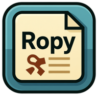

<p align="center"></p>

<h2 align="center"><em><strong>R</strong>opy <strong>O</strong>rganizes <strong>P</strong>revious <strong>Y</strong>anks</em></h2>

<p align="center">
<a href="https://github.com/studentweis/ropy/blob/main/LICENSE"></a>
<a href="https://github.com/studentweis/ropy/releases"></a>
<a href="https://rust-lang.org"></a>
<br>
<a href="https://github.com/studentweis/ropy"></a>
<a href="https://github.com/studentweis/ropy/issues"></a>
</p>

<p align="center">使用 Rust 和 GPUI 编写的跨平台原生剪贴板管理器。</p>

<p align="center">
<a href="../../README.md">English</a> | 简体中文
</p>

<p align="center">

</p>

## 特性

- 使用 Zed 的 GPUI 构建的原生桌面应用。
- 跨平台支持：Windows、macOS 和 Linux（X11 与原生 [Wayland](../WAYLAND.md)）；剪贴板和快捷键能力取决于合成器支持。
- 追踪文本、富文本（HTML/RTF）、图片和文件路径剪贴板历史，并基于内容进行去重。
- 支持列表和网格布局模式切换，灵活浏览历史记录。
- 支持使用大小写敏感和整词匹配选项搜索已加载的历史记录。
- 支持收藏和置顶记录；自动清理时会保留已置顶和已收藏的内容。
- 支持通过可配置的悬浮延迟或按住 `Space` 预览文本和图片。
- 可配置全局快捷键、主题、语言、开机自启和确认模式。
- 提供系统托盘集成，以及应用内检查更新、下载和安装更新的流程。

## 安装

### 预编译二进制文件

您可以从 [Releases](https://github.com/StudentWeis/ropy/releases) 页面下载最新的预编译二进制文件。

### macOS

通过自建 [Homebrew tap](https://github.com/StudentWeis/homebrew-tap) 安装：

```sh
brew install --cask studentweis/tap/ropy
```

使用 `brew upgrade --cask ropy` 升级。应用内仍可检查新版本，安装交由
Homebrew 管理。当前发布尚未签名，自建 Cask 会在安装后自动移除 Ropy.app
的 `com.apple.quarantine` 下载隔离属性，保留其他扩展属性；这不等于签名或公证。
若清理失败，安装会停止并显示错误；如果系统仍阻止启动，请在确认来源后，通过系统设置
→ 隐私与安全性允许 Ropy 运行。

下载 `.dmg` 文件并将 Ropy.app 拖到应用程序文件夹后，您可能需要移除隔离属性才能正常运行应用程序。打开终端并运行以下命令：

```sh
xattr -rc /Applications/Ropy.app
sudo xattr -r -d com.apple.quarantine /Applications/Ropy.app
```

### Windows

您可以使用 [Scoop](https://scoop.sh/) 安装 Ropy：

```powershell
scoop bucket add extras
scoop install ropy
```

> [!NOTE]
> Ropy 会识别标准路径下的 Scoop 安装，并交由 Scoop 更新。请运行 `scoop update ropy`；应用内仍可检查新版本。

### Linux（X11 与 Wayland）

当前源码支持原生 Wayland 窗口，无需 XWayland 或 `DISPLAY`。该支持由
[PR #234](https://github.com/StudentWeis/ropy/pull/234) 引入；使用预编译二进制时，
请确认对应版本的发布说明是否包含此变更。

运行 `ropy --show` 可打开历史窗口。Wayland 下可使用桌面授权的 GlobalShortcuts
Portal、已支持的 Hyprland 集成，或在合成器中为 `ropy --show` 配置快捷键。
平铺合成器可能需要额外配置浮动窗口规则。

剪贴板监听需要 data-control 协议，自动粘贴还需要 virtual-keyboard 协议。
已完成原生 Sway 实测；GNOME、KDE 和 Niri 尚未逐一验证。配置方法、备用唤起方式
和能力限制请参阅 [Wayland 指南](../WAYLAND.md)。

### 从源码构建

确保您已安装 Rust（通过 `rustup`）。然后：

```bash
git clone https://github.com/StudentWeis/ropy.git
cd ropy
cargo build --release
./target/release/ropy
```

### 开发命令

安装 GNU Make、Bash 和 `awk` 后（Windows 可使用 MSYS2 等兼容环境），执行 `make` 或 `make help` 查看开发命令。Cargo 使用 `rust-toolchain.toml` 中固定的 Rust 版本；格式化还需要 nightly rustfmt（`rustup toolchain install nightly --profile minimal --component rustfmt`）。

```sh
make build          # 调试构建
make build-release  # 优化构建
make run            # 启动调试版应用
make test           # 运行测试
make fmt-check      # 检查 Rust 格式
make precheck       # 格式化代码并执行完整的提交前检查
```

其他目标包括 `check`、`clippy`、`fmt`、`doc` 和 `clean`。`make setup` 调用 `scripts/init.sh` 安装开发工具及 hk Git hooks（hk 2.5+）。请先安装 [uv](https://docs.astral.sh/uv/getting-started/installation/)；YAML、TOML 和 JSON 检查通过 `uvx` 运行固定版本的解析器。安装脚本会替换现有的 pre-commit hook。使用 `hk check --all` 检查文件，使用 `hk fix --all` 修复文件。如果提交钩子修改了文件，请审阅并暂存修改后重新提交。预检查脚本需要 Python 3 和 Clippy（`rustup component add clippy`）。直接调用 Cargo 的目标支持 `make build CARGO="rtk cargo"` 等覆盖方式；脚本目标沿用各自的命令选择逻辑。

## 使用

- 启动 Ropy —— 它会隐藏在系统托盘中并开始记录剪贴板历史。
- 使用全局快捷键或托盘图标打开历史窗口。
- 按 `/` 聚焦搜索，然后使用大小写敏感、整词匹配和类型筛选来优化结果。
- 使用 `Up`/`Down` 或 `J`/`K` 在条目间移动，按 `Enter` 或 `1`-`5` 确认选择。
- 按 `Shift+Enter` 以纯文本格式粘贴富文本记录。
- 在网格模式下，使用 `H`/`L` 在列之间移动。
- 按住 `Space` 预览选中的记录，按 `F` 收藏它，按 `Delete` 或 `D` 删除它。
- 使用行内操作置顶记录，使其排除在存储清理之外。
- 在设置中选择 `copy_to_clipboard` 或 `paste_immediately` 确认模式。

## 局限性（无计划支持）

- 系统剪贴板不会暴露复制条目的原始应用程序来源。
- 插件/扩展系统：目前没有计划 —— Ropy 专注于简洁和小体积。
- 云同步：目前不支持。
- 完整的命令行历史管理：Ropy 主要提供 GUI；Linux 下的 `ropy --show` 用于打开图形窗口。

## 致谢

- 灵感来自其他剪贴板管理器，如 Ditto、Maccy 和 CopyQ。
- 感谢 Rust 社区以及 Ropy 使用的所有上游项目：[GPUI Kit](https://github.com/longbridge/gpui-kit)、[clipboard-rs](https://github.com/ChurchTao/clipboard-rs)、[redb](https://github.com/cberner/redb) 以及其他依赖项目。

## Star 历史

<a href="https://www.star-history.com/?repos=studentweis%2Fropy&type=date&legend=top-left">
 <picture>
   <source media="(prefers-color-scheme: dark)" srcset="https://api.star-history.com/chart?repos=studentweis/ropy&type=date&theme=dark&legend=top-left" />
   <source media="(prefers-color-scheme: light)" srcset="https://api.star-history.com/chart?repos=studentweis/ropy&type=date&legend=top-left" />
   
 </picture>
</a>
